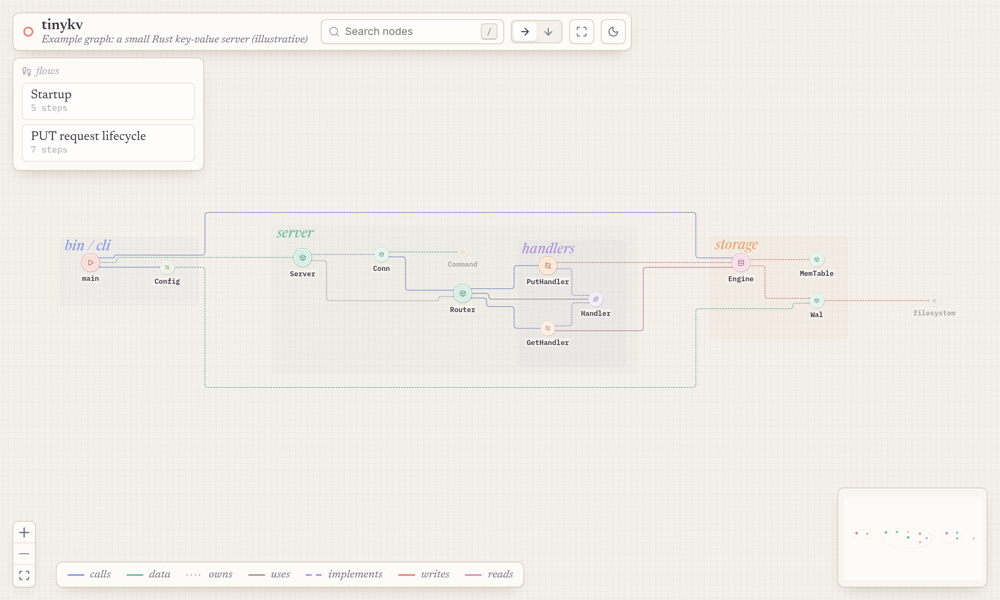
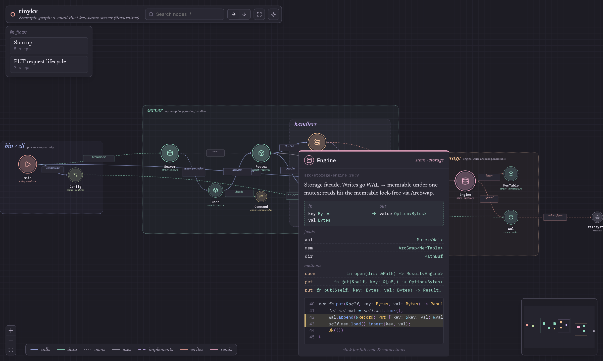
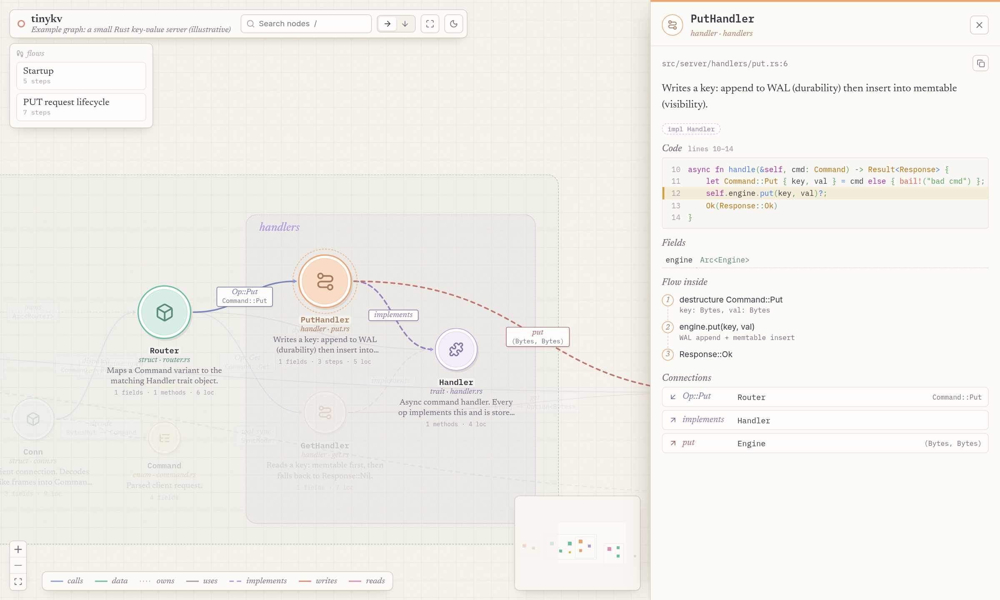
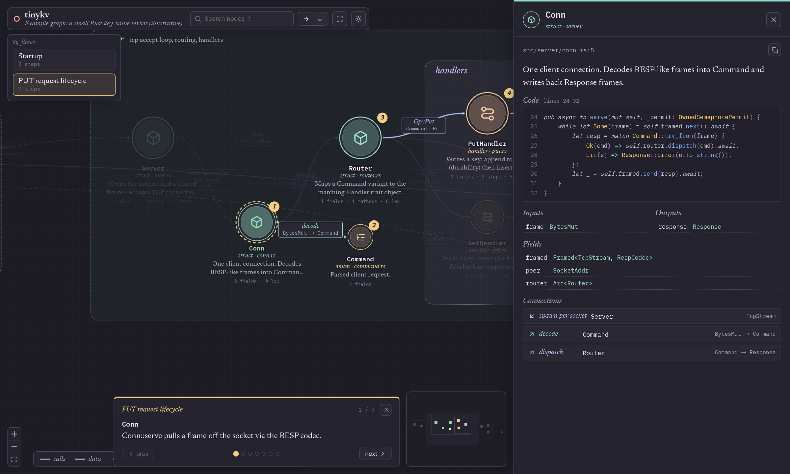

# codeflow

An agent skill that **maps a codebase into an interactive flow graph**. The agent reads the repo,
works out how data and control move through it, and writes one JSON file. The bundled React viewer
turns that file into an n8n-style canvas you can zoom, hover and click through.



## What you get

- **Circular nodes** for entrypoints, structs, traits/interfaces, handlers, functions, stores and
  external systems. Edges show `calls`, `data` (with the payload type), `impl`, `owns`,
  `reads`/`writes`, `emits` and `returns`.
- **Semantic zoom.** Zoomed out you see the architecture: modules, the main types, big labels.
  Zooming in fades in summaries, field/method counts and edge payload types.
- **Hover card**: summary, signature, inputs → outputs, fields, methods, the data flow *inside*
  the node, and a code snippet. You can move into it and scroll it.
- **Inspector** on click: the full source (pulled from disk, never invented), notes, and every
  connection, each clickable to jump to it.
- **Flow tours**: step-by-step walkthroughs ("PUT request lifecycle", "Startup"). The camera follows
  each step and a caption narrates what the data looks like there.
- Module grouping (ELK layered layout), search (`/`), left→right or top→bottom layout, edge-kind
  filters, minimap, deep links, **light + dark** pastel themes, springy animations.

| Hover card (dark) | Inspector (light) |
|---|---|
|  |  |



## Install

It's a standard [Agent Skill](https://docs.claude.com/en/docs/claude-code/skills) (`SKILL.md` +
resources), so it works with Claude Code and any agent that loads skills from a folder.

```sh
git clone https://github.com/daschinmoy21/codeflow ~/.claude/skills/codeflow
cd ~/.claude/skills/codeflow/viewer && bun install
```

Requires [bun](https://bun.sh). On NixOS without bun installed, use `nix shell nixpkgs#bun -c bun install`.

## Use

Ask your agent something like *"map this repo with codeflow"*, *"show me how a request flows
through the server"*, or run `/codeflow`. The agent then:

1. reads the entrypoints and traces the main paths,
2. writes `<repo>/.codeflow/<name>.json` with line ranges, not code
   ([schema](references/schema.md)),
3. runs `bun scripts/cli.ts hydrate` to fill in the real code from disk, then `check` to validate,
4. starts the viewer and gives you the URL.

You can also run the viewer yourself:

```sh
cd ~/.claude/skills/codeflow/viewer
env CODEFLOW_GRAPHS=/path/to/repo/.codeflow bun run dev            # live, hot-reloads the JSON
env CODEFLOW_GRAPHS=/path/to/repo/.codeflow CODEFLOW_OUT=/tmp/site bun run build   # one self-contained HTML file
```

With no `CODEFLOW_GRAPHS`, it shows the bundled example (`viewer/graphs/example.json`, a small,
made-up Rust key-value server).

Deep links: `#g=<graph>&n=<node>` selects a node, `#flow=<id>` starts a tour, and
`#theme=light|dark` forces a theme, and `#dir=down` starts in the top→bottom layout. Press `/` to search
(↑/↓ + Enter to pick a result), `F` to fit the view, `←`/`→` to step through a tour and `Esc` to close.

## Layout

```
SKILL.md               instructions the agent follows
references/schema.md   graph JSON reference
viewer/
  graphs/example.json  example graph
  scripts/cli.ts       hydrate (code from disk) + check (validation)
  src/                 React + @xyflow/react + elkjs + prism-react-renderer
```

The graph format is language-agnostic. Code highlighting covers Rust, Go, Python, TS/JS, C/C++,
Swift, Kotlin, JSON, YAML, GraphQL and Markdown; anything else renders as plain text.

## License

MIT
